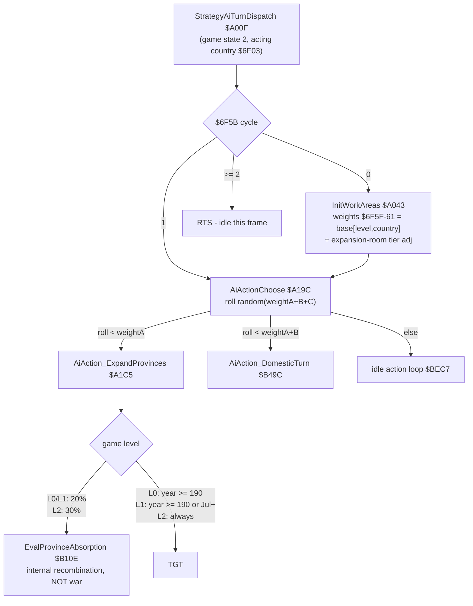
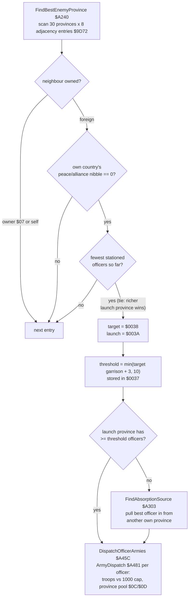
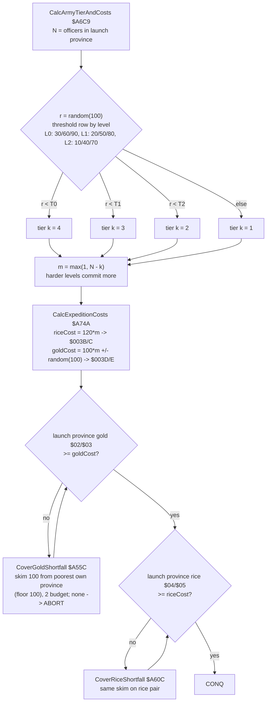
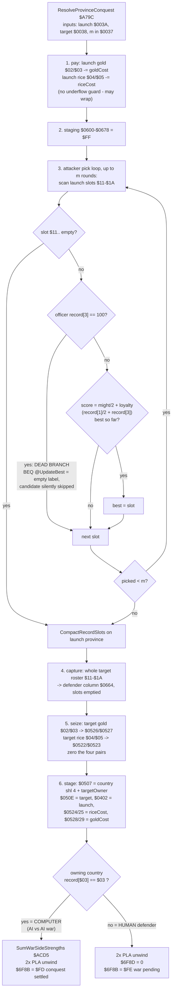
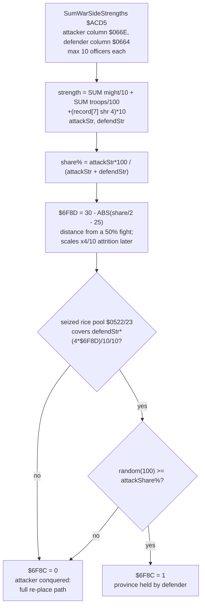
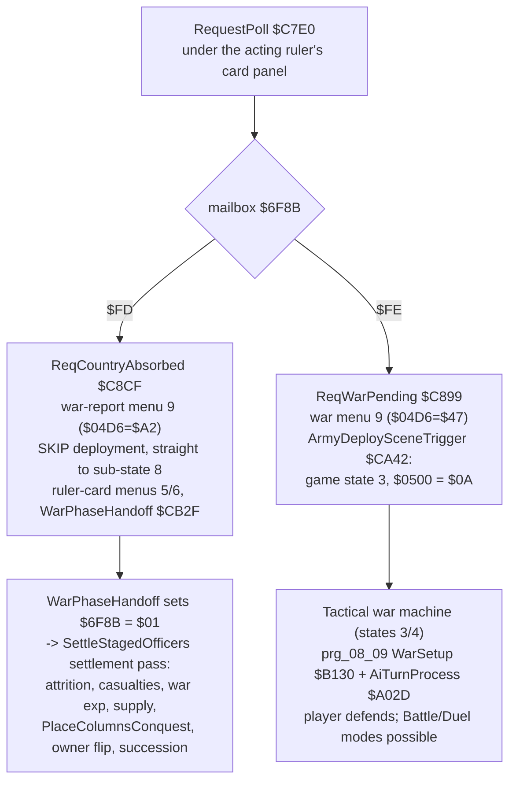
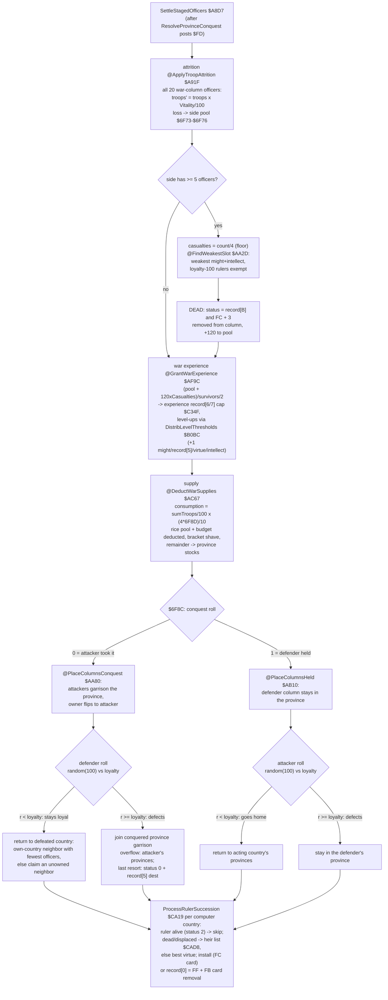

# AI vs AI War Resolution — Decision Tree (prg_0a_0b conquest pipeline)

Companion to the four AI decision-tree docs (`strategy_ai_decision_tree.md`,
`tactical_ai_decision_tree.md`, `battle_ai_decision_tree.md`,
`duel_ai_decision_tree.md`). This document answers a narrower question:
**when two computer countries go to war, where is the code, and why does the
game never show Tactical / Battle / Duel mode?**

Short answer: an AI-initiated war against an AI-owned province never enters
the banks $08+$09 tactical war machine. It is resolved instantly inside the
Strategy Mode AI turn (banks $0A+$0B, `prg_0a_0b.asm`) as a **province
conquest**: the target province's roster and stocks are seized, the war
against its owning country is staged, and the owning country's **control byte
`record[$03]`** decides the outcome — `$03` (computer) → `$6F8B = $FD`
*conquest settles instantly, skip the war scene*; anything else (human pad
0–2) → `$6F8B = $FE` *war pending*, the only way the AI conquest pipeline can
launch a real tactical war (the player defending). The branch lives in
`ResolveProvinceConquest` ($A8B7–$A8C3). Country destruction and ruler
succession are NOT done here — they happen later in the conquest-continue
pass (`SettleStagedOfficers` → `ProcessRulerSuccession`).

## The control byte (country record[3]) — why "3 = computer", not "at war"

Several legacy comments read `record[3] == $03` as "at war"; the byte-level
evidence says it is the ruler control mode (`0–2` = human pad, `3` =
computer):

| Site | Evidence |
|---|---|
| prg_0c_0d $A418–$A42F | Loads both countries' record[3] into $0562/$0563 — the Battle Mode per-side control mode; `== 3` gates `Phase1AiSideRefresh` (AI assigns orders), human sides get orders from the phase-3 UI (byte-verified in `battle_ai_decision_tree.md`) |
| prg_0a_0b $B754–$B762 | Alliance gift: recipient with [3]==$03 accepts **silently**; otherwise the Yes/No prompt is posted through mailbox $F8 — only a human needs a prompt |
| prg_0a_0b $BB05 | Existing comment literally: "Check if new officer is AI-controlled" before the [3]==$03 test |
| prg_0a_0b $BBF4–$BBFA | SowDiscord target scan skips [3]==$03 countries (scheming only pays off against humans) |
| prg_19_1a $CDDD–$CE1E | Debug hook (armed by ROM-space byte $FFF9, inert in the shipped ROM) backs up and rewrites all seven control bytes $6F0A…$6F3A (stride 8) |
| prg_08_09 $D97A–$D98B | Caveat: post-war the *same* 8-byte record area is reused as result-entry records, where byte 3 means "entry fresh/consumed" ($03 written by `WarResultEntryInit`). Do not confuse that reuse with the control byte. |

## Entry points (all prg_0a_0b unless noted)

| Address | Procedure | Role in the AI-vs-AI war |
|---|---|---|
| $A00F | `StrategyAiTurnDispatch` | State-2 per-frame driver; $6F5B cycle: 0 = seed weights, 1 = act |
| $A043 | `InitWorkAreas` | Seeds expand/domestic/loop weights $6F5F–$6F61 (base[level*8+country] + expansion-room tier adj) |
| $A19C | `AiActionChoose` | Weighted dice → entry 0 = `AiAction_ExpandProvinces` (the war action) |
| $A1C5 | `AiAction_ExpandProvinces` | Readiness gates + target selection sequence |
| $A240 | `FindBestEnemyProvince` | Picks the weakest adjacent enemy province |
| $A303 | `FindAbsorptionSource` / `CompareValues` $A3D6 | Reinforces the launch province with the best officer |
| $A45C | `DispatchOfficerArmies` / `ArmyDispatch` $A481 | Muster bookkeeping per officer (1000-troop cap vs province pool) |
| $A6BC/$A6C9 | `LevelTierDispatch` / `CalcArmyTierAndCosts` | Attack roll: how many officers commit + expedition cost |
| $A74A | `CalcExpeditionCosts` | cost = committed × (120 rice, 100 gold ± noise) |
| $A55C / $A60C | `CoverGoldShortfall` / `CoverRiceShortfall` (solvency top-up helpers, formerly TileRender / NameTable) | Drain 100 from the poorest own provinces to cover gold/rice cost |
| $A79C | `ResolveProvinceConquest` | Executes the province conquest + **the AI-vs-AI / vs-human branch** |
| $ACD5 | `SumWarSideStrengths` | Post-conquest settlement math |
| $A8D7 | `SettleStagedOfficers` | Staged-column settlement (mailbox $01): attrition, casualties, war exp, supply, re-placement, succession |
| prg_19_1a $C7E0 | `RequestPoll` (frame-9 AI-turn panel) | Consumes $FD/$FE: war-report menus vs deployment launch |

## Key RAM

| RAM | Meaning |
|---|---|
| `$6F03` | `sram_current_country` — acting (attacking) country id |
| `$6F02` | game level (0–2); drives every threshold table below |
| `$0037` | garrison threshold → repurposed as committed-officer count `m` |
| `$0038` | target (enemy) province id |
| `$003A` | launch (own) province id |
| `$003B/$003C` | riceCost = 120·m |
| `$003D/$003E` | goldCost = 100·m ± random(0..99) |
| `$066E…` | attacker column (top-m officers), consumed by the settlement |
| `$0664…` | defender column (captured roster), consumed by the settlement |
| `$0522/$0523` | war rice pool (seized defender rice) |
| `$0526/$0527` | war gold pool (seized defender gold) |
| `$0524/$0525`, `$0528/$0529` | staged cost copies (rice/gold) |
| `$0507` | war faction pair = actingCountry<<4 \| targetOwner |
| `$050E` | `war_province_idx` = target province |
| `$0402` | launch province (post-war bookkeeping) |
| `$6F8B` | `sram_game_start_flag` mailbox: $FD / $FE / $01 / $FF |
| `$6F8D` | conquest adjust from the settlement (scales ×4/10 attrition) |
| `$6F73-$6F76` | war pools (defender/attacker): lost troops + 120×casualties, converted into war experience for survivors |
| `$6F77/$6F78` | casualty counts (defender/attacker column) |
| `$6F8C` | conquest outcome: 0 = attacker took the province, 1 = defender held |

## Decision tree 1 — will this AI start a war at all?



## Decision tree 2 — target and muster



## Decision tree 3 — attack tier, cost, solvency



## Decision tree 4 — `ResolveProvinceConquest` $A79C (the conquest, one frame)



## Decision tree 5 — settlement (`SumWarSideStrengths` $ACD5)



## Decision tree 6 — mailbox playback (prg_19_1a frame-9)



## The algorithm in detail

### 1. War decision (DT1)

- `AiActionChoose` $A19C rolls a weighted die over $6F5F (expand) / $6F60
  (domestic) / $6F61 (idle). Weights are per `(level, country)` base tables
  ($A133/$A14B/$A163) plus a tier adjustment ($A17B…) from
  `AiCountExpansionRoom` $A0D3: the share (100·few-officer border provinces /
  own-or-empty border edges) → tier 0/1/2 at <31% / <71% / else.
- Inside `AiAction_ExpandProvinces` $A1C5: first a 20% (L0/L1) / 30% (L2)
  chance diverts to `EvalProvinceAbsorption` $B10E — that is internal
  recombination (pull thin border provinces into richer ones), **not** a war.
- Readiness gate $A1E4: level 0 attacks only from year 190, level 1 from
  year 190 **or** July onward, level 2 always.

### 2. Attack roll and cost (DT3)

```
r      = random(100)
T[level] = [30,60,90] L0 | [20,50,80] L1 | [10,40,70] L2   ($A6C0 table)
k      = 4 if r<T0, 3 if r<T1, 2 if r<T2, else 1
m      = max(1, N_officers - k)        ; committed officers — harder levels commit more
riceCost  = 120 * m                    ; $003B/$003C
goldCost  = 100 * m + s·random(100)    ; $003D/$003E, s = ± by B1F_RandomByte2 >= $80
```

### 3. ResolveProvinceConquest $A79C — decode

1. **Pay** ($A79C–$A7C4): launch province gold pair `[$02/$03] -= goldCost`,
   rice pair `[$04/$05] -= riceCost`. No underflow guard — pairs may wrap.
2. **Clear staging** ($A7C6): $0600–$0678 ← $FF.
3. **Attacker pick** ($A7D0–$A829): up to m rounds. Each round scans launch
   slots $11–$1A; an empty slot breaks out early. Per officer the score is
   `might/2 + loyalty` (`record[1]/2 + record[3]`), best tracked in $2C/$2D
   (later slot wins ties). **ROM quirk:** the `record[3] == $64` test branches
   to `@UpdateBest`, which is an *empty label* — the intended
   loyalty-100-auto-best body is missing, so loyalty-100 officers are
   silently skipped from selection. Each pick writes $FF into its slot and
   appends the officer id to the attacker column $066E. Ends with
   `CompactRecordSlots` on the launch province.
4. **Capture** ($A831–$A84C): the target province's whole roster $11–$1A is
   lifted into the defender column $0664, slots emptied.
5. **Seize** ($A84E–$A874): target gold `[$02/$03]` → $0526/$0527, target
   rice `[$04/$05]` → $0522/$0523 (same pool layout as the player sortie,
   prg_19_1a `SortieWarCommit` $B7D9); the four pairs are zeroed.
6. **Stage** ($A876–$A8AB): `$0507 = actingCountry<<4 | targetOwner`,
   `$050E` = target province, `$0402` = launch province, $0524/$25 = riceCost,
   $0528/$29 = goldCost.
7. **Branch** ($A8AE–$A8D6): owning country `record[$03] == $03` →
   `SumWarSideStrengths` + `$6F8B = $FD` (instant settlement); otherwise
   `$6F8B = $FE`, `$6F8D = 0`. Both exits unwind two return frames (2× PLA),
   skipping the remainder of `AiAction_ExpandProvinces`.

### 4. Settlement and aftermath (DT5/DT6)

```
$6F8C (conquest outcome):  seized rice pool $0522/23 cannot cover
                           defenderStrength*(4*$6F8D)/10/10
                           -> 0 (attacker took the province)
                           else random(100) >= attackerShare% -> 1 (defender held), else 0
```

$6F8D scales the per-officer attrition (×4/10) applied in
`ApplyScenarioDeductions` / the settlement pass of `SettleStagedOfficers` $A8D7
(reached because the frame-9 flow hands the mailbox to $01 at
`WarPhaseHandoff` prg_19_1a $CB7B). $6F8C selects the settlement path
($00 = conquest: `@PlaceColumnsConquest` + owner flip at $A906, $01 = province
held: `@PlaceColumnsHeld`, no flip), which ends in `ProcessRulerSuccession` —
the losing ruler's country is extinguished or succeeded, provinces having
flipped owner nibble by `AND #$F8 / ORA $6F03` ($A906).

### 5. Officer fates: HP, troop attrition, capture, death

All of this runs in `SettleStagedOfficers` $A8D7 after the $FD/
$01 mailbox ack — before it, the conquest path ($6F8C = 0) also runs
`ApplyScenarioDeductions` $CD68, which applies $6F8D-bracket-scaled
deductions to province resource fields (not officers).

**Officer status byte** — `record[$B]` bits 0-1 (bits 2-3 = army affinity,
bits 4-7 = level). Values: `0` = released, destination in record[5];
`1` = free agent (hireable: poach/hire success writes 2 at $C655/$C769);
`2` = garrisoned (alive); `3` = dead. The seed ROM uses bits 0-3 as affinity;
placement code overwrites the low bits with status 2 when officers are
assigned to provinces. Death marking is always `AND #$FC / ORA #$03` — the
same op the tactical clash aftermath uses at prg_0c_0d $B60D when an
officer's HP hits 0 (followed by the exp-grant callback and war-slot clear).

1. **HP/Vitality is never deducted** in the AI-vs-AI settlement. Vitality
   (`record[0]`, the officer's HP stat) acts as the attrition coefficient:
   **troops' = troops × Vitality / 100** (@ApplyTroopAttrition $A91F, all 20
   war-column officers; 10-bit troop pair, record[9] bits 2-7 flags kept).
   Vitality 100 keeps everything, 50 loses half. The loss goes into the
   side's pool ($6F73/$74 defenders, $6F75/$76 attackers) — later converted
   into war experience, see item 3.
2. **Casualties = death** (@CountColumnsMarkCasualties $A9CC + @FindWeakestSlot $AA2D):
   per side with ≥5 surviving officers, **floor(count/4) of the WEAKEST
   officers die** — minimum might+intellect (`record[1]+record[2]`),
   loyalty-100 (rulers) exempt. They are marked status 3, removed from the
   column (never re-placed), and each contributes a flat 120 to the side's
   troop pool.
3. **War experience + level-ups** (@GrantWarExperience $AF9C — misnomer, it grants
   experience): side pool += 120×casualties, pool ÷ survivors, then
   @DistributeToSlot $B067 adds **half** the share to each survivor's
   **experience** `record[6/7]` (16-bit, capped at $C34F). When experience
   reaches `DistribLevelThresholds` $B0BC (1000/2000/3500/5000/7500/10000/
   15000) the officer levels up (`record[$B]` bits 4-7, max 14) and gains one
   +1 stat: might (< 51), else record[5] (< 71), else virtue (< 81), else
   intellect (< 90).
4. **Supply consumption** (@DeductWarSupplies $AC67): per side,
   consumption = (Σ troops / 100) × (4 × $6F8D) / 10. The seized rice pool
   $0522/23 pays the defender's consumption, the expedition rice budget
   $0524/25 pays the attacker's (both clamped at 0). `BracketDeductGold`
   $CE67 / `BracketDeductArmy` $CEDD then shave a table-bracket fraction
   (ArmyDeductionTable/ArmyResultTable $CEC9/$CED3) off the rice and gold
   pools (their header comments mislabel the fields: $0522/23 = rice pool,
   $0526/27 = gold pool). Remainders are written back into the province:
   rice [$04/$05] = $0522+$0524, gold [$02/$03] = $0526+$0528.
5. **Capture** — there is no POW state. "Captured" means the target
   province's whole roster was lifted into the defender column $0664 by
   `ResolveProvinceConquest`; fate is decided by a loyalty roll at
   re-placement (decision tree 7 below). Note the polarity: **high loyalty →
   returns to its own country** (best = own-country neighbor province with
   the fewest officers, else claims an unowned neighbor province),
   **low loyalty → defects** into the war province (overflow: the other
   side's provinces; last resort: status 0 + record[5] = random adjacent
   province — the officer wanders off with a destination marker).
6. **Ruler death / succession** (ProcessRulerSuccession $CA19, per computer
   country): ruler `record[0]` empty → skip; ruler status == 2 (still
   garrisoned = alive) → skip (the `@RulerAlreadyDead` label is a mislabel);
   otherwise (killed by casualties, or displaced with status 0/1) →
   AppointSuccessor: first heir from the country's `HeirPriorityList`
   ($CAD8, e.g. Cao Cao → Cao Pi → Cao Rui → …) found governing one of its
   provinces, else the best-virtue (record[4]) officer in its rosters;
   install (country record[0] = heir, heir loyalty = 100, mailbox $FC
   card-swap notice) or no successor → record[0] = $FF + mailbox $FB
   card-removal notice. Post-succession defection pass (@ScoreAndAdjust
   $CBA3): officers with loyalty < 31 get a 20% chance to leave (status 0 +
   record[5] destination), rosters compacted, officer-less provinces become
   unowned (owner $07).

Death in AI-vs-AI wars is therefore pure arithmetic — casualty marking and
(on the human-defender $FE path) `WarClashResolve` HP-to-0. No duel scene,
no execution menu.

## Decision tree 7 — officer fates in the settlement



### 6. Why Battle and Duel modes can never appear

Both modes live downstream of the tactical war scene (game states 3/4 →
banks $0E+$0F Battle Mode, $17+$18 Duel Mode). The AI-vs-AI branch never
leaves banks $0A+$0B/$19+$1A: `ResolveProvinceConquest` takes the $FD path,
the deployment trigger is skipped, so no scene that could host Battle/Duel UI
is ever launched. Even inside genuine wars, AI-vs-AI officer clashes are
plain arithmetic — `WarClashResolve` prg_08_09 $B933 resolves a pending
strike as
`damage = defenderAttack($0B byte)*10 + defenderLevel*random(30..40)/10`
applied to the striking officer's HP (clamped ≥ 0), with two ROM quirks: the
`random < 101` roll at $B9E2 is discarded, and the level-difference +10 bonus
at $B9DD is overwritten before use (dead computation).

## Applied renames (2026-09-21)

All renames are comment-column-preserving; ca65 error-set verified unchanged.

| Old | New | Addr | Why |
|---|---|---|---|
| `TileRender` | `CoverGoldShortfall` | $A55C | not a renderer: skims 100 gold from poorest own province (floor 100) into the launch province |
| `NameTable` | `CoverRiceShortfall` | $A60C | same helper for the rice pair $04/$05 |
| `CalcArmyTierAndRender` | `CalcArmyTierAndCosts` | $A6C9 | rolls tier / committed count / costs; no rendering |
| `CalcTierWorkPtr` | `CalcExpeditionCosts` | $A74A | computes rice 120·m and gold 100·m±rand costs |
| `SumEnemyRecords` | `SumWarSideStrengths` | $ACD5 | sums BOTH sides' strength for the settlement |
| `ResolveCountryAbsorb` | `ResolveProvinceConquest` | $A79C | the target is a Province ($0038); no country is absorbed here — country destruction happens later in SettleStagedOfficers/ProcessRulerSuccession |
| `InitNewGameContext` | `SettleStagedOfficers` | $A8D7 | settles the staged officer columns $0664/$066E (attrition, casualties, war exp, supply, re-placement, succession handoff); initializes no new game — name came from misreading $6F8C == 0 as "new-game setup". Internal misnomers renamed too: `@ClearGameStateVars`→`@ApplyTroopAttrition`, `@CountRecords`→`@CountColumnsMarkCasualties`, `@AdjustGold`→`@GrantWarExperience`, `@SumAllResources`→`@SumColumnTroops`, `@SubtractBattleCosts`→`@DeductWarSupplies`, `@PlaceNewArmies`/`@PlaceNewEnemies`→`@PlaceColumnsConquest`/`@PlaceColumnsHeld` |
| `@RenderLoop` | `@GoldSolvencyLoop` | $A705 | gold solvency retry loop |
| `@SubtractLimitB` | `@RiceSolvencyCheck` | $A727 | rice solvency check |
| `@RenderTileLoop`/`@RenderNameLoop` (TransferProvinceValues) | `@GoldSolvencyLoop`/`@RiceSolvencyLoop` | $B242/$B264 | same top-up retry loops; mislabeled branch refs ($B238, $B256, $B278) corrected to the ROM branch-byte targets, exit `@Exit` $B286 labeled |
| `@DeadTarget` | `@Done` | $A79B | plain RTS exit, not a dead target |

## Correction notes for legacy comments

- "status/byte 3 = at war" comments (prg_08_09 $B157 region, prg_0a_0b
  $B758/$BB09/$BBF8, `WarAttackerSetup`/`WarDefenderSetup` headers) describe
  the **computer-control byte** tested against $03, not a war state. The
  branch documented in DT4 is the decisive evidence together with the
  Battle Mode input-mode load.
- "defender still has forces" as the $FE condition (prg_19_1a legacy
  comments) is wrong: $FE means **human defender** (control byte ≠ $03),
  regardless of remaining forces; $FD means **computer defender**.
- `@SubLimitB` ($B224, delta clamp in `TransferProvinceValues`) is a distinct
  label and stays.
