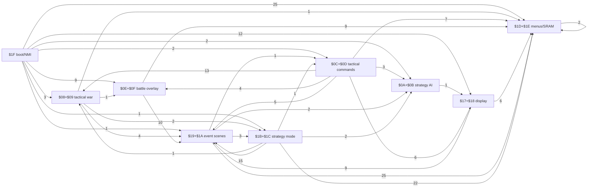
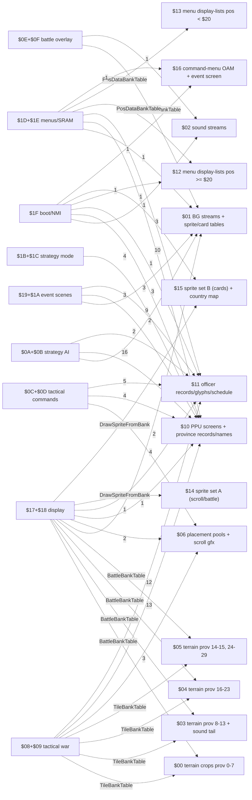

# PRG Bank Switch Linkage Map

Sangokushi 2 - Haou no Tairiku (J) / Namco-163 (Mapper 19)

Maps every PRG bank-switching call site found in `prg_1f_boot.asm` and all
eight disassembled bank pairs (`prg_08_09_tactical_war`, `prg_0a_0b_strategy_ai`,
`prg_0c_0d_tactical_commands`, `prg_0e_0f_battle`, `prg_17_18_display`,
`prg_19_1a_event_scenes`, `prg_1b_1c_strategy_mode`, `prg_1d_1e_menu_screens`) to its
target bank(s). Every PRG bank is now disassembled; the $8000-window data banks
$00-$07 and $10-$16 are decoded in `asm/banks/data_*` (section 5.2).

There are exactly two families of PRG switch primitives, with disjoint
effects:

- **Code PRG switches** — `SwitchBankAC_A` / `SwitchBankAC_B` and
  `BankedCallbackTrampoline`. These change the code banks mapped at
  $A000-$FFFF ($A000-$DFFF switchable; $E000-$FFFF = fixed bank $1F).
- **Data PRG switches** — `SwitchBank8_A` / `SwitchBank8_B`. These change
  only the $8000-$9FFF window (data lookup). They do **not** change code
  banks $A000-$FFFF.

Raw per-line scan data: [bank_switch_scan_raw.txt](bank_switch_scan_raw.txt)
(generated by `tools/scan_bank_links.py`; successor tool
`tools/find_undisassembled_targets.py`).

---

## 1. Switching primitives (all in fixed bank $1F)

### 1.1 Code PRG bank switches ($A000-$FFFF)

| Primitive | Addr | Windows affected | Shadow RAM |
|---|---|---|---|
| `SwitchBankAC_B` | $F237 | $A000 = Y, $C000 = Y+1 | $00E2 / $00E3 (slot B) |
| `SwitchBankAC_A` | $F24B | $A000 = Y, $C000 = Y+1 | $00DF / $00E0 (slot A) |
| `BankedCallbackTrampoline` | $EE07 | $A000/$C000 via `SwitchBankAC_B` (slot B), then JMP to inline `.word` target | saves caller bank ($00E2) to $0058 |
| `BankedCallbackReturn` | $EE4D | pulls saved bank from stack, restores slot B via `SwitchBankAC_B` | — |

Implementation notes:

- Effective PRG bank = `Y & $1F` (32 x 8KB banks; bit 5+ is electrically
  ignored by the mapper). Callers usually pass `Y = $2x` (slot-A context)
  or `Y = $3x` (slot-B context).
- `SwitchBankAC_*` writes `NAMCO_PRG_C000` ($F000) with the raw bank number
  (Y+1), then writes `NAMCO_PRG_A000` ($E800) with `bank | $C0` — bits 6-7
  disable CHR-RAM for that window.
- `BankedCallbackTrampoline` calling convention:
  `LDY #bank; JSR BankedCallbackTrampoline; .word target`. It reads the
  caller's current slot-B $A000 bank from $00E2 (so trampoline calls always
  run in slot-B context), pushes `$EE4C` and the saved bank below the
  target's return address, then JMPs to the `.word` target in the new bank.
  The target routine must end in `JSR/JMP BankedCallbackReturn` to restore
  the caller's bank before RTS.
- `.word` targets such as $A000/$A003/$A015 are entry points in **other**
  banks (resolved from Y via `& $1F`), never addresses in the calling file.
- Two independent "slots" exist so NMI can restore context: `NmiHandler`
  ($F800) re-writes registers from slot-B shadows $E1/$E2/$E3;
  `NmiEpilogue` ($F88D) restores slot-A shadows $DE/$DF/$E0 before RTI.

### 1.2 Data PRG bank switches ($8000 window only)

| Primitive | Addr | Window affected | Shadow RAM |
|---|---|---|---|
| `SwitchBank8_B` | $F25F | $8000 = Y | $00E1 (slot B) |
| `SwitchBank8_A` | $F266 | $8000 = Y | $00DE (slot A) |

- Single `STY NAMCO_PRG_8000` ($E000) plus shadow save — nothing else.
- These switches **never** touch code banks $A000-$FFFF; the $8000 window is
  used purely to read data tables/graphics from the selected bank.

### 1.3 Not a PRG switch

| Routine | Addr | Effect |
|---|---|---|
| `BankSwitch` | $E51F | **CHR only** (8-byte config $E0/$E1 pages); no PRG effect | (shadow $00E6-$00ED) |

---

## 2. Code-bank linkage matrix (SwitchBankAC / trampoline)

$A000/$C000 16KB-pair targets. `$xx+$yy` = pair; `$xx` = $A000 window only.
Only bank $1F calls `SwitchBankAC_A/B` directly; every other bank reaches
code in other banks exclusively through `BankedCallbackTrampoline`.

| Source | Code targets in $A000/$C000 | Mechanism |
|---|---|---|
| **$1F** (boot, states, NMI) | $08+$09, $0A+$0B, $0C+$0D, $0E+$0F, $17+$18, $19+$1A, $1B+$1C, $1D+$1E | direct `SwitchBankAC_A/B` |
| **$08+$09** (tactical war/AI) | $0E, $19, $1B+$1C, $1D+$1E | trampoline |
| **$0A+$0B** (strategy AI/domestic) | $17+$18 | trampoline |
| **$0C+$0D** (tactical player turn) | $08+$09, $0A+$0B, $0E, $17+$18, $19, $1D+$1E | trampoline |
| **$0E+$0F** (battle overlay) | $19, $1D+$1E | trampoline |
| **$17+$18** (display) | $19, $1D+$1E | trampoline |
| **$19+$1A** (event scenes) | $0A+$0B, $0C+$0D, $1B+$1C, $1D+$1E | trampoline |
| **$1B+$1C** (strategy mode) | $08+$09, $0A+$0B, $0C+$0D, $19, $1D+$1E | trampoline |
| **$1D+$1E** (menus/SRAM) | $1D+$1E (self pair) | trampoline |

All code-bank pairs are disassembled, so every trampoline target above resolves
to a decoded entry stub. Bank $00 is
not a code target — the site once suspected of calling it ($0C $A022) was
verified against ROM bytes: `LDY #$28` -> bank $08, `.word $A015` =
`B08_09_StratagemTargetMarker_Entry` (`JMP DrawStratagemTargetMarkers` in
bank $08).

---

## 3. Data-bank linkage matrix (SwitchBank8, $8000 window)

Single 8KB bank targets. Never affects code banks.

| Source | Data banks in $8000 |
|---|---|
| **$1F** (boot, states, NMI) | $02 (sound), $10, $11, $12, $15, $16 |
| **$08+$09** (tactical war/AI) | $00, $03, $04, $05 (terrain, via `TileBankTable`), $06, $10, $11 |
| **$0A+$0B** (strategy AI/domestic) | $01 (slot B, sprites), $10, $11 |
| **$0C+$0D** (tactical player turn) | $06, $10, $11 |
| **$0E+$0F** (battle overlay) | $01 (battle cell maps, via `BattleCellMapBankTable`), $02 (sound streams) |
| **$17+$18** (display) | $00, $03, $04, $05 (battle scene, via `BattleBankTable`), $01, $06, $10, $11, $14/$15 (sprites, `DrawSpriteFromBank`) |
| **$19+$1A** (event scenes) | $01 (officer card tables), $10, $11 |
| **$1B+$1C** (strategy mode) | $10 |
| **$1D+$1E** (menus/SRAM) | $01, $10, $11, $12/$13 (via `PosDataBankTable`), $16 |

Dynamic $8000 tables: `TileBankTable` ($B8BB in $08), `BattleBankTable`
($A822 in $17), `PosDataBankTable` ($A6A7 in $1D), `DrawSpriteFromBank`
(bit7 of A selects $14 vs $15 in $17), `BattleCellMapBankTable` ($BB48 in
$0E — all phases select $21, i.e. bank $01).

---

## 4. Per-source detail

### 4.1 Bank $1F (prg_1f_boot.asm)

**Code switches** — direct `LDY #imm ; JSR SwitchBankAC_*`:

| Caller | Y | Target pair | Purpose |
|---|---|---|---|
| State_StrategyMapLaunch $E110 | $37 | $17+$18 | `B17_18_PpuCopyRaw` display |
| State_StrategyMapLaunch $E118, $E134, $E13F | $3D | $1D+$1E | palette record / `B1D_1E_MenuUpdate` |
| State_StrategyAiTurnFrame $E182 | $2A | $0A+$0B | Strategy Mode AI turn dispatch (`StrategyAiTurnDispatch_Entry` $A000) |
| State_WarSceneLaunch $E19A, $E1D9 | $37 | $17+$18 | war scene display; `B17_18_DataRecordLoader` installs the war layer's `($A8)` quadrant zone table (see [bank_00_data_layout.md](bank_00_data_layout.md) §2) |
| State_WarSceneLaunch $E1A9 | $2C | $0C+$0D | `B0C_0D_OfficerFateCommit_Entry` (post-battle officer-fate commit, $0500=$0B) |
| State_WarSceneLaunch $E1B4 | $28 | $08+$09 | `B17_18_PpuCopyRaw`-equivalent in $08 (normal mode) |
| State_WarSceneLaunch $E1E1 | $3D | $1D+$1E | `B1D_1E_StateHandler` |
| State_WarAiTurnFrame $E226 | $28 | $08+$09 | War/tactical AI turn frame (`B08_09_AiTurnProcess_Entry` $A000) |
| State_StrategyMode $E247 | $37 | $17+$18 | display |
| State_StrategyMode $E24F, $E27B | $3D | $1D+$1E | domestic dispatch |
| StrategyCommandLookup $E2BB | $37 | $17+$18 | action graphics by $0544 |
| State_DuelSceneLaunch $E315 | $37 | $17+$18 | duel scene display |
| State_DuelSceneLaunch $E31D, $E34C | $3D | $1D+$1E | duel scene dispatch |
| DisplayInit $E372 | $3D | $1D+$1E | bank display |
| State_CountryMapView $E3B2 | $37 | $17+$18 | map view display |
| State_CountryMapView $E3BA, $E3CD | $3D | $1D+$1E | map view dispatch |
| State_NewGameSetup $E424 | $37 | $17+$18 | new-game setup |
| State_NewGameSetup $E42C..$E447 | $3D | $1D+$1E | new-game setup (SramInit re-seed) |
| State_EventMessageScene $E492 | $37 | $17+$18 | message scene display |
| State_EventMessageScene $E49A, $E4AA | $3D | $1D+$1E | message scene dispatch |

Caller names follow `prg_1f_boot.asm`; the sub-state based attribution of the
launch states is in `code/initial_data_tables.md` §9.

**Data switches** — $8000 window (`SwitchBank8_A/B`):

| Caller | Y | Bank | Purpose |
|---|---|---|---|
| State_StrategyMapLaunch $E0E9 | $30 | $10 | `StrategyMapBaseScreen` -> PPU $2000 (1KB via `PpuCopyRaw` $E113) |
| State_DuelSceneLaunch $E2FC | $30 | $10 | `DuelBaseScreen` -> PPU $2000 (1KB via `PpuCopyRaw` $E318) |
| State_CountryMapView $E38B | $35 | $15 | map graphics |
| State_NewGameSetup $E3FD | $32 | $12 | new-game setup tiles |
| State_EventMessageScene $E479 | $36 | $16 | `EventMessageSceneScreen` -> PPU $2000 (1KB via `PpuCopyRaw` $E495) |
| GetNameDisplayScale $F30D | $30 | $10 | name width data |
| GetOfficerRomRecordAddr $F389 | $31 | $11 | officer records |
| SoundNotePlayer $E60B | $22 | $02 | 4-byte note header entry at $8000+soundID*4 |

The third bank-$10 screen is not switched from `$1F` at all: `ScenePageCopy`
$BC9D (bank $1D+$1E) selects $30 and streams `TacticalTerrainScreen` to PPU
$2400.

**NMI sub-dispatch** ($EE53): bit4-7 of $007E trigger `LDY #$3D;
SwitchBankAC_B; JMP` into bank $1D jump-table entries:

| $007E bit | Target |
|---|---|
| bit3 | $1D $A00C `B1D_1E_MapDisplaySetup` |
| bit2 | $1D $A006 `B1D_1E_VRAMBufferWrite` |
| bit1 | $1D $A012 `B1D_1E_FlushTileBuffer` |
| bit0 | $1D $A000 `B1D_1E_PPUTileRender` |

**NMI state handlers** ($F87B table, indexed by `addr_sub_state` ($0078) &
`$0F` - *not* by `addr_game_state`; `NmiHandler` does `LDA $78 / AND #$0F / ASL /
JMP (table)` at `$F866`-$F878, so a state proc picks its VBlank handler by the
sub-state it stores): every handler starts with `$0E+$0F` (Y=$2E, shared
font/tile data), then state-specific pairs, finally re-selects the pair the
interrupted code was using:

| Handler | Additional pairs touched |
|---|---|
| NmiState2_StrategyMap | $1D+$1E, $1B+$1C |
| NmiState3_WarScene | $17+$18, $19+$1A, $0C+$0D, $1D+$1E |
| NmiState4_Battle | ($0E+$0F only) |
| NmiState5_Duel | $17+$18, $1D+$1E |
| NmiState6_TitleScreen | $0A+$0B |
| NmiState7_CountrySelect | $1D+$1E, $08+$09 |
| NmiState8_EventMessage | $1D+$1E, $17+$18 |
| NmiHandler_Busy | $0E+$0F |

### 4.2 Banks $08+$09 (prg_08_09_tactical_war.asm — tactical war layer)

Per `docs/manual_kb/terminology.md`, this bank implements the army-level
Tactical/War layer (war setup, tactical AI, attrition, war results), not the
piece-based Battle Mode sub-scenario. Procedure names use the `War*` prefix.

**Code switches (trampoline):**

| Caller | Y | Target |
|---|---|---|
| AiOfficerActionDispatch $C1FC, $C2D1 | $3B | $1B+$1C $A003 -> ActionDeltaInputPoll ($DA02, war-scene action delta input) |
| WarAttritionRound $CE1B | $2E | $0E $A006 (tile write w/ offset) |
| CountrySelect_PickEntry $D896 | $3D | $1D+$1E `B1D_1E_OfficerDisplay_Lookup` |
| CountrySelect_InspectEntry/Finalize, CountrySelectMenuPoll | $39 | $19 $A000 (RLE PPU writer) |
| CountrySelectMenuPoll $D93D | $39 | $19 $A012 (war-result dispatch) |

**Data switches ($8000, slot A unless noted):** $06 (AiTurnProcess,
WarSetup), $10 (AiTurnProcess, WarSetup, WarPhaseProcess,
UpdateOfficerCoords, AiOfficerActionDispatch, SetupPostWarState), $11
(AiTurnProcess, WarSetup, UpdateOfficerCoords,
WarCasualtyResolution, DrawStratagemTargetMarkers).

**Dynamic:** `GetTileTerrainClamped::@GetTileTerrain` ($B71C) reads
`TileBankTable` ($B8BB, zone-indexed): values $20/$23/$24/$25 -> physical
banks **$00/$03/$04/$05** hold the 16-column terrain quadrant crops - 4 per
province, 15 + 5 content rows assembled into the 32x20 tactical map (format and
per-zone offsets: [bank_00_data_layout.md](bank_00_data_layout.md)).

### 4.3 Banks $0A+$0B (prg_0a_0b_strategy_ai.asm)

**Code switch (trampoline):** `CallTitleAnimationDispatch` $D72A (JSR at $D72C), Y=$37 -> $17+$18
`B17_18_AnimationDispatch_Entry` ($A021). The same absolute address holds the unrelated
bank-$0A mid-proc label `StrategyAiTurnDispatch::AiOfficerPhaseEntry`; the window decides which runs.

**Data switches ($8000):**

- Slot A: $10 x16 (record/province data across the AI turn:
  AiCountExpansionRoom, FindBestEnemyProvince, SettleStagedOfficers,
  EvalProvinceAbsorption, AiAction_DomesticTurn, CalcActionProb,
  AiOfficer_RecruitTransfer, PromoteBestOfficerForCountry,
  CountDefendedBorderProvinces, CollectEnemyBorderProvinces/X, BuildAdjacencyBitmap),
  $11 x2 (EvaluateAndMarkOfficer, ReadBankedRecordField).
- Slot B: $01 (Y=$21) for StateSpriteAnim and DrawSelectionSprites
  (sprite/animation data).

### 4.4 Banks $0C+$0D (prg_0c_0d_tactical_commands.asm — tactical player turn)

The acting player's officer commands on the war map during Tactical Mode;
the AI counterpart is banks $08+$09 (section 4.2).

**Code switches (trampoline).** All outbound $A000/$C000 traffic uses the
trampoline. Jump-table entry = `$A000 + 3*idx`.

| Caller | Y | Target bank | Target entry |
|---|---|---|---|
| TacticalTurnFrameUpdate $A00E | $28 | $08 | $A012 (war status panel) |
| (frame preamble) $A015 | $28 | $08 | $A021 (map scroll update) |
| (frame preamble) $A022 | $28 | $08 | $A015 `B08_09_StratagemTargetMarker_Entry` (DrawStratagemTargetMarkers) |
| WarOrder_Input $A0E8 | $3D | $1D | $A027 `B1D_1E_ProvinceDataHandler` |
| OfficerDetail_RenderWait $A257, $A262 | $39 | $19 | $A000 / $A012 |
| MoveState_CheckDest $A4D0 | $28 | $08 | $A027 (war result scene init) |
| MoveState_Select $A579 | $2E | $0E | $A006 (tile write) |
| MoveState_Select $A5BB | $3D | $1D | $A027 |
| StratagemState_Init $A8BB | $28 | $08 | $A01B (build command list) |
| StratagemState_Cancel $AADD | $3D | $1D | $A027 |
| ExecStratagem_Enticement $B3AD | $2A | $0A | $A006 `B0A_0B_ArmyValueCalc_Entry` |
| ApplyLoyaltyChange $B62A | $2E | $0E | $A009 (display scroll loop) |
| ApplyLoyaltyChange $B63D | $28 | $08 | $A02A (slot clear) |
| ApplyGoldChange $B6EA | $2E | $0E | $A006 |
| TurnEndState_Confirm $BCF8 | $3D | $1D | $A027 |
| ArmyTurnEnd_Commit $BE0C | $28 | $08 | $A00F (attrition round) |
| ArmyTurnEnd_SwitchRuler $BE69 | $28 | $08 | $A00C (casualty resolution) |
| AiMarch $BFA0, $C016, $C158 | $3D | $1D | $A027 |
| TownAction $C1FE | $28 | $08 | $A009 `WarTownActionDispatch` (town facility actions — buy/sell rice, hospital; entered at tactical_turn_state 9 after march arrival) |
| ArmyDeploy $C360, $C39C | $39 | $19 | $A000 / $A012 |
| OfficerLevelUp $C73D | $28 | $08 | $A018 (validate special officer) |
| OfficerFateCommit $C7AF | $2E | $0E | $A009 |
| OfficerFateCommit $C7D5 | $28 | $08 | $A02A |
| OfficerFateCommit $C815, $C880 | $2A | $0A | $A00C (DistanceClamp) / $A006 (ArmyValueCalc) |
| TacticalMapScene $D4F5 | $28 | $08 | $A006 (war phase process) |
| TacticalMapScene $D72E, $DB6D | $37 | $17 | $A012 (battle dispatch) |
| TacticalMapScene $D7B5 | $37 | $17 | $A018 (advisor tiles) |
| TacticalMapScene $D7E0, $D827, $D847 | $37 | $17 | $A015 (overlay window) |
| TacticalMapScene $DC45 | $39 | $19 | $A000 |
| TacticalMapScene $DF12 | $28 | $08 | $A018 |

**Data switches ($8000):** $06 x4 (ArmyDeploy), $10
(ProvinceSelect_InitList, UnitWithdraw, TacticalMapScene x2),
$11 (WarSideStatDigitsRender, TacticalMapScene x3).

### 4.5 Banks $0E+$0F (prg_0e_0f_battle.asm — battle overlay + animation/sound)

Battle Mode overlay — the per-VBlank UI state machine running on top of the
battlefield scene rendered by banks $08+$09 — plus the battle animation and
sound engine. Entered through a 5-entry jump table; every NMI state handler
maps this pair first (Y=$2E) for the shared font/tile helpers (section 4.1).

**Code switches (trampoline):**

| Caller | Y | Target |
|---|---|---|
| BattleVBlankFrameUpdate $A026 | $3D | $1D $A003 `B1D_1E_MenuUpdate` |
| BattleOverlayIntroDataFormatTop $A12E, BattleOverlayIntroDataFormatBottomAndAdvance $A147, CommandConfirmWait $AB91, CommandResultWait $ABAC, AiTauntSceneStep $D771 | $3D | $1D `B1D_1E_DataFormatter` (data panel render) |
| CommandAnimStep $AAEA, SideAFormationPanelInit $CE55, SideBFormationPanelOpen $CFB2 | $3D | $1D `B1D_1E_OfficerDisplay_Render` |
| BattleModeStateLoop $A04D/$A064, CommandSelect $AA35, BattleTacticsMenu $ACD7, FormationAdvance $B1FE, SideAFormationMenuInput $CE77, SideAFormationConfirmWait $CEBD, SideBFormationMenuInput $CFD1, SideBFormationConfirmWait $D017, AiTauntStripRedraw $D73D | $39 | $19 $A000 `B19_1A_OverlayStripRender_Entry` |

**Data switches ($8000):** $02 (BattleAnimSoundEngine $D8D6, Y=$22 — the
command-stream walker that continues into bank $03, see 5.2); dynamic via
`BattleCellMapBankTable` ($BB48 — all entries $21): `BattleCellRedraw` $B89B
and `BattleTerrainPassabilityCheck` $CB02 map bank $01 and read the battle
cell maps through `BattleCellMapPtrTable` ($BB1E).

### 4.6 Banks $17+$18 (prg_17_18_display.asm)

**Code switches (trampoline):**

| Caller | Y | Target |
|---|---|---|
| DuelCmd_RoundSetup, Surrender_Init, DuelPursue_Init, DuelPursue_SetupPursuer, TacticDialog_Init (all via `B1F_BankedCallbackTrampoline`) | $3D | $1D $A030 `B1D_1E_OfficerDisplay_Render` |
| TacticDialog_LoadName | $3D | $1D $A033 `B1D_1E_OfficerNameDisplay` |
| Diplomacy_ShowMenu, DuelData_ShowCard, StrategyCommand_InitOfficerDisplay, StrategyCommand_UpdateOfficerDisplay | $39 | $19 $A012 `B19_1A_OfficerCardAnimStep_Entry` |
| TacticDialog_LoadCards x2, SetupMenuPtr, StrategyCommand_UpdateOfficerDisplay (2nd call), StrategyCommand_ScrollOfficerList | $39 | $19 $A000 `B19_1A_OfficerCardRender_Entry` (officer card renderer: body + face expression, portrait CHR page from `$CED6`) |

**Data switches ($8000):**

| Caller | Bank | Notes |
|---|---|---|
| DomesticDisplay, AnimSeq_PlayFrames | $01 | animation frames |
| `StrategyCommandDispatch` $D693 (older name: DomesticActionDispatch), `ScrollPanel_LoadRow` $DC13 via `RenderDispatchSprite` $DBF3 | $06 | strategy scroll tile rows + OAM sprite blobs ($95E6-$9FBB); see 5.2 |
| DomAction_BuildOfficerList | $10 | officer list data |
| DomesticAffairs_BuildSpriteData | $11 | sprite data |
| BattleDispatch::BattleResolve, OverlayWindow (LoadOverlayPrimary) | **dynamic** | `BattleBankTable` ($A822): idx 0-31 -> $20, 32-55 -> $23, 56-63 -> $25, 64-95 -> $24, 96-119 -> $25; physical banks **$00, $03, $05, $04, $05** hold battle scene tiles/overlays — the same 16x16 terrain quadrant maps as the `TileBankTable` path, see [bank_00_data_layout.md](bank_00_data_layout.md) §7 |
| DrawSpriteFromBank | $14 / $15 | bit7 of A selects set A ($34) vs set B ($35) |

### 4.7 Banks $19+$1A (prg_19_1a_event_scenes.asm)

The event/scene bank: a 17-entry jump table ($A000-$A030) of scene dispatchers —
officer card renderer, Country rotation / next-Ruler turn handoff (also the
title-screen attract cycle), Strategy request dispatch, monthly events,
Officer status scene, Exchange-march cutscene, Ruler succession, Unification
ending, Province officer roster, castle development result roll, goods send,
SRAM save commit, and the map dirty-bit marker. Several entries double as
shared PPU helpers for other banks (OverlayStripRender at $A000 is the
war-result/battle-overlay strip renderer).

**Code switches (trampoline):**

| Caller | Y | Target |
|---|---|---|
| CountryRotationDispatch $A0B8 / $A160 | $3D | $1D `B1D_1E_YearDisplaySetup` / `B1D_1E_SlowPeriodic` |
| DroughtDamageScene $A855, FloodDamageScene $AACF, ProvinceRebellionEvent $AC8C, OfficerReinforceScene $AFAB, UnificationEndingDispatch $C5CD, StrategyRequestDispatch $C95B/$C996/$CCD2 | $3D | $1D $A02A `B1D_1E_OfficerDisplay_Lookup` |
| OfficerStatusScene $ADA1 / $AEB2 | $3D | $1D `B1D_1E_YearDisplaySetup` |
| StrategyRequestDispatch ($C810-$CB56, 11 sites) | $3D | $1D $A042 `B1D_1E_RulerCardRefresh` |
| ProvinceOfficerRosterDispatch $AFFC, StratagemCutscene $D3E7 | $3D | $1D $A015 `B1D_1E_PaletteRecordLoad` |
| ProvinceRebellionEvent $AC2F, StrategyRequestDispatch $CA32 | $3B | $1B $A009 `B1B_1C_ProvinceZoneOriginGet_Entry` |
| RulerSuccessionScene $BEE2 | $3B | $1B $A006 `B1B_1C_OfficerSelectDialogPoll_Entry` |
| RulerSuccessionScene $C05B, SuccessionApplyScene $C2EA | $2A | $0A $A009 `B0A_0B_DataRecordLookup_Entry` |
| StrategyRequestDispatch $CA7E | $2C | $0C $A003 `B0C_0D_TacticalMapSceneInit_Entry` |

**Data switches ($8000):** $01 (OfficerCardRender $CE39 and
StratagemCutscene x3, Y=$21 — the officer card class/sprite tables, see
5.2), $10 (CardFillDispatch, OfficerArrivalScan, OfficerNaturalDeathScene),
$11 (CountryCensusBuild, OfficerReinforceScene, CardFillDispatch,
OfficerArrivalScan, OfficerNaturalDeathScene, StratagemCutscene —
officer records and glyphs).

### 4.8 Banks $1B+$1C (prg_1b_1c_strategy_mode.asm)

**Called from bank $1F (code switch):** NmiState2_StrategyMap ($F8EF) switches
Y=$3B and JSR $A000 -> `StrategyFrameUpdate` ($A00C): per-frame Strategy Mode
update (ruler marker sprites via `MapRulerMarkerDraw` $DE83, animated
province sprites via `MapProvinceSpriteRefresh` $DF35, then frame-state
dispatch by $0400 through `B1F_CallbackDispatcher`). Entry $A000 is a stub
aliasing $A00C; $A003/$A006/$A009 jump to ActionDeltaInputPoll ($DA02) /
OfficerSelectDialogPoll ($D64A) / $DF25.

**Code switches out (trampoline, from StrategyFrameUpdate and its
frame-state table $A025-$A044):**

| Caller | Y | Target |
|---|---|---|
| StrategyFrameUpdate $A014 | $39 | $19 $A02A (MapProvinceDirtyMark: marks pending province $0402 in dirty bitmap $04E0-$04E3) |
| frame state $0B handler $A047 | $39 | $19 $A003 |
| frame state $0C handler $A04F | $39 | $19 $A021 |
| frame state 9 handler $A057 | $39 | $19 $A006 |
| frame state $0A handler $A05F | $39 | $19 $A009 |
| frame state $0D handler $A067 | $39 | $19 $A00C |
| frame state $0E handler $A06F | $3D | $1D $A039 `B1D_1E_SceneRenderer` |
| frame state $0F handler $A077 | $39 | $19 $A01E |

**Note:** bank $19 entry stubs are 3-byte JMPs ($A000->$CE1F, $A003->$A033,
$A006->$C773, $A009->$A296, $A00C->$AD81, $A01E->$C435, $A021->$AFE5,
$A02A->MapProvinceDirtyMark); several are shared with battle overlay usage.
The $04E0-$04E3 dirty bitmap is set by bank $19 $A02A and consumed/cleared
each frame by `MapProvinceSpriteRefresh`.

Beyond the frame machine, most of the bank is Strategy Mode command logic: the
command category menu and the Castle, Army, Warehouse, Town and Intrigue command
dispatchers (StrategyFrameStateTable states 1-6, 12,632 B = 77% of the bank) plus
their shared dialog/numeric-input helpers (ConfirmDialogPoll,
OfficerSelectDialogPoll, OfficerTroopPoolAssignPoll, ActionDeltaInputPoll) and
MapRulerIntroDispatch. The map-screen plumbing (ruler marker, province sprites,
camera scroll, hit-test) is 975 B = 6%. Their outbound trampoline traffic:

| Caller | Y | Target |
|---|---|---|
| Call* wrappers $A047-$A077 | $39 / $3D | $19 scene dispatchers (CountryRotation, ProvinceOfficerRoster, StrategyRequest, MonthlyEvent, OfficerStatus, UnificationEnding) / $1D `B1D_1E_SceneRenderer` |
| MapRulerIntroDispatch $A0E4 | $3D | $1D `B1D_1E_SlowPeriodic` |
| CastleCommandDispatch | $39 / $3D / $2A | $19 `B19_1A_CastleDevResultRoll` / `B19_1A_SramSaveCommit`, $1D `B1D_1E_OfficerDisplay_Lookup` / `B1D_1E_ImmediateOverlay`, $0A `B0A_0B_ArmyValueCalc_Entry` |
| ArmyCommandDispatch | $39 / $2C / $3D | $19 `B19_1A_SortieWarCommit`, $0C `B0C_0D_TacticalMapSceneInit_Entry`, $1D `B1D_1E_ImmediateOverlay` |
| WarehouseCommandDispatch | $39 / $3D | $19 `B19_1A_TransferCapacityCalc`, $1D `B1D_1E_OfficerDisplay_Lookup` |
| TownCommandDispatch | $28 / $39 / $3D | $08 `B08_09_ExpandArmoryGridSlots_Entry`, $1D `B1D_1E_OfficerDisplay_Lookup` / `B1D_1E_ImmediateOverlay` |
| IntrigueCommandDispatch | $39 / $3D | $19 `B19_1A_GoodsSendPrepare` / `B19_1A_GoodsSendApply`, $1D `B1D_1E_ImmediateOverlay` / `B1D_1E_OfficerDisplay_Lookup` |
| PoachRosterTransfer $D46C | $2A | $0A `B0A_0B_ArmyValueCalc_Entry` |
| ConfirmDialogPoll $D622/$D62A | $3D | $1D `B1D_1E_ImmediateOverlay` / `B1D_1E_FastPeriodic` |
| CastleScoutOutcomeRoll $DC18 | $39 | $19 `B19_1A_OfficerArrivalScan` |
| OfficerCardShow $DD6A | $39 | $19 `B19_1A_OverlayStripRender_Entry` |

**Data switches ($8000):** $10 (TownCommandDispatch x2, IntrigueCommandDispatch,
ProvinceAdjacencyValidate — item/ruler-name records and adjacency).

### 4.9 Banks $1D+$1E (prg_1d_1e_menu_screens.asm)

**Code switch (trampoline):** OfficerDisplay_Lookup $A89B and
DomesticMenu_Return $C95D, Y=$3D -> self pair, $A015
`B1D_1E_PaletteRecordLoad`.

**Data switches ($8000):**

| Caller | Bank | Notes |
|---|---|---|
| MenuUpdate, OfficerListHandler, ScenePageCopy, SramInit, StateHandler | $10 | menu/scene data |
| OfficerNameSpritePost, StateHandler, SramInit | $11 | banked data; OfficerNameSpritePost reads the 13-byte Officer name-glyph records at `$8DB4 + id*$0D` |
| MenuRenderer (`@render_menu` $BE6A -> `@menu_dispatch_table` $BE75, MenuAction00-22) | $16 | command-menu OAM sprite-layout blobs: 34 x 1-6-entry `.word` tables (`MenuOamPtrTable_00-21`, `$8000-$9B91`) over 130 `[y,tile,attr,x]` + `$80` blobs; each handler sets `tile_ptr` ($0010/$0011) to its table, `LDY $04A1` (or `$04A4`), and `DisplayTileData` ($C994) reads the word with a high-byte `SBC #$40` (stored word = blob + $4000), sets Y base $000A = $2F / X base $000C = $20 (or $90), attr EOR $0002 = 3, then `B1F_SpriteOamWriterSimple`; also `State_EventMessageScene` $E477 -> 1 KB `EventMessageSceneScreen` $9B92 -> PPU $2000 |
| MenuFontRecordLoad | $01 | menu font graphics |
| MenuUpdate `CmdDrawName*` handlers | save/restore | `LDA cur_bank_8000 ($E1); PHA`, switch to $10 or dynamic bank from command stream (`LDA ($A6),Y`), then `PLA; TAY; JSR B1F_SwitchBank8_B` to restore |
| MenuUpdate (sprite pos) | **dynamic** | `PosDataBankTable` ($A6A7): $33/$32 -> physical **$13/$12** |

---

## 5. Target-bank roles (inferred)

### 5.1 Code banks (mapped at $A000/$C000 via SwitchBankAC / trampoline)

| Bank | Role (as observed) |
|---|---|
| $1F | fixed boot bank: state machine, NMI, sound, all switch primitives |
| $08+$09 | tactical war engine (disassembled) - also used as PPU-copy provider at boot |
| $0A+$0B | strategy AI turn / domestic engine (disassembled) |
| $0C+$0D | tactical-mode player turn engine (disassembled): the acting player's officer commands on the war map — move, attack, stratagem, march, deploy, exchange, retreat — plus the tactical_turn_state 9 hand-off to bank $08's WarTownActionDispatch. The AI side of the same layer is banks $08+$09 |
| $0E+$0F | battle-mode overlay UI state machine + battle animation/sound engine (disassembled); also the shared font/tile helper pair every NMI state handler maps first |
| $17+$18 | display engine (disassembled) |
| $19+$1A | event/scene bank (disassembled): officer card renderer, Country rotation / turn handoff (and title attract cycle), Strategy requests, monthly events (flood/drought/rebellion/reinforce/natural death), officer status scene, exchange-march cutscene, ruler succession, unification ending, SRAM save commit; $A000 doubles as the shared overlay-strip/RLE renderer for war results and the battle overlay |
| $1B+$1C | strategy-mode command menus + map frame machine (disassembled): the $0400 frame-state machine ($A000/$A00C), the command category and Castle/Army/Warehouse/Town/Intrigue command dispatchers (states 1-6 — 77% of the bank) with their shared officer-select, confirm-dialog and numeric-input helpers; the map-screen plumbing (ruler marker + province sprites + camera) is only 6%; war-scene action delta input ($A003 -> ActionDeltaInputPoll $DA02, called from banks $08+$09 AiOfficerActionDispatch), ProvinceZoneOriginGet |
| $1D+$1E | menus / domestic dispatch / SRAM (disassembled) |

### 5.2 Data banks (mapped at $8000 via SwitchBank8 only)

| Bank | Role (as observed) |
|---|---|
| $00 | 32 terrain quadrant crops (16x16 grids of terrain tile bytes) = provinces 0-7 x 4 quadrants; `GetTileTerrainClamped` ($B6E5, prg_08_09_tactical_war) assembles 4 of them into each province's 32x20 tactical map (15 content rows from the upper crops + 5 from the lower), through `TileBankTable` + the `($A8)` zone table; Battle Mode re-reads the same bytes because `BattleTilePtrTable`/`BattleOverlayPtrTable` alias those pointers. Decoded in [bank_00_data_layout.md](bank_00_data_layout.md) |
| $01/$03-$05/$07 | data assets: terrain quadrant maps ($03/$04/$05, same ribbon format as $00, provinces 8-29), sprite/animation frames and BG streams ($01 decoded in [data_01_bg_and_sprites.asm](../asm/banks/data_01_bg_and_sprites.asm) — strategy-mode BG tile/attribute nametables, menu font CHR records, selection/strategy animation sprites, the officer card class-base + face-expression sprite tables read by the bank $19 card renderer, and the battle cell maps read by banks $0E+$0F through `BattleCellMapBankTable`; $07 is **entirely blank** — all 8192 bytes are $FF, and no code site selects it (the dynamic bank tables above carry only $20-$25/$32-$35; the sole `LDY #$27` at prg_0c_0d_tactical_commands $DD25 is a RAM-clear bound, not a bank select); recorded in [data_07_blank.asm](../asm/banks/data_07_blank.asm) as `.res $2000, $FF`.). Bank $03 is dual-purpose: the sound driver also maps it at $A000, so its offsets $0000-$0965 ($8000-$8965) are the tail of the bank $02 command-stream area and its terrain crops only start at $89A6 (the $0966-$09A5 gap is that first crop's 64 B attribute head, see [bank_00_data_layout.md](bank_00_data_layout.md) §5a); `tools/terrain_model.py` labels the area `sound_stream`/`sound_tail`. |
| $02 | sound/note data, decoded in [asm/banks/data_02_sound.asm](../asm/banks/data_02_sound.asm); format and coverage proof in [tools/sound_streams.py](../tools/sound_streams.py). `SoundNotePlayer` ($E609, bank $1F) arms one track per soundID via `LDY #$22`/`SwitchBank8_B` from the 4-byte descriptor at `$8000 + soundID*4`; the `SoundWrapper0..F` fall-through chain plays contiguous IDs (a fanfare = a run of descriptors, silence slots included). Layout: `$8000-$82DB` = `SoundNoteHeaderTable` (183 descriptors: b0 = sound-RAM track offset, stride $16, 11 tracks; b1 = hardware channel 0-7 = APU 0-3 then Namco-163 4-7; b2/b3 = the stream's full 16-bit CPU address, b3 stored at $0703 as b3+$40; $0700 <- $00 arms the track, $FF = idle), `$82DC-$9FFF` = `SoundCommandStreams` (166 packed streams: 4-byte note record [tick, duty source, channel control byte, sweep] then 2-byte command cells - pitch <$A0 with sustain, $A0-$A4 control/sweep/duty/vibrato, $B0-$BF jumps and counted loops over a $FD marker, $C0-$CF tremolo, $D0-$EF volume LFO, $FF ends a stream and its operand byte is the next stream's first byte). The descriptor row at `$82DC` doubles as the shared silence note that 17 soundIDs point at, so the stream area really begins there ($82E0 is only its first terminator). The driver maps bank $03 at $A000 while walking ($D8D4-$D8E0), so soundIDs $A4-$B6 stream out of bank $03 and the area ends at bank $03 $8965. The wavetable is NOT here - it is `WavetableInitData` ($E6A6, bank $1F). |
| $06 | decoded in [asm/banks/data_06_placement_and_scroll.asm](../asm/banks/data_06_placement_and_scroll.asm) (rendered by `tools/gen_data_bank_06_asm.py`, gate `tools/verify_data_bank_06.py`; replaces the older "AI + domestic action data" guess). Two payloads. (1) `$8000-$95E5` — the Tactical layer's **unit placement pools and city bounds rectangles**: four 30-entry `.word` tables keyed by `war_province_idx` ($050E), attack pools from `$8000` (91 x 34 B), defense pools from `$8C52` (53 x 32 B), and parallel rect tables `$932E`/`$94D6` (91/53 x 4 B, `[row_min,col_min,row_max,col_max]`). This is the arrangement selected by `TacticalAttackSideTypeTable` (bank $10 `$9E62`) and `TacticalDefenseSideTypeTable` (bank $11 `$9AB4`); each pool is an anchor (row,col) followed by 15 unit tiles consumed through four per-slot cursors (`@AttackerCursorSeeds` `$02/$0C/$16/$1C`, `@DefenderCursorSeeds` `$02/$08/$0C/$14`), and the rects gate which tile the army-deploy command may pick. Pool rows skip 15, matching the terrain codec's row-15 quirk. (2) `$95E6-$9FBB` — the strategy scroll screen's graphics: 3 x 392 B tile-row blocks (14 rows x 28, streamed to PPU `$2082` rows 4-17 by `ScrollPanel_LoadRow`) and OAM sprite-blob tables of 21/4/6 entries (phase 1/2/3), all in the `[y,tile,attr,x]` + `$80` format of bank `$01`. |
| $10 | three pre-baked PPU screens (`$8000-$8BFF`, see code/initial_data_tables.md §9), province master records (`$8C00`), rice-buy rates (`$8FC0`), katakana name tables, province adjacency (`$9D72`) - heaviest $8000 data bank |
| $11 | officer records / sprite data |
| $12/$13 | the two menu display-list banks of the `B1D_1E_MenuUpdate` stream VM (format: [pputilerender_stream_architecture.md](pputilerender_stream_architecture.md)); `PosDataBankTable` ($A6A7) picks $32 when pos id >= $20 AND sub_state ($007A) is 3-8, else $33, and `CalcMenuDataPtr` ($A61D) biases the stored pointer word by +$4000 in bank $12 / +$2000 in bank $13 (its `CMP #$09`/`CMP #$03` ladder on the returned table index). Each bank: 256-entry `.word` pointer table `$8000-$81FF` (index = pos id) over packed display-list streams ($8200 up). Bank $12 serves the pos ids >= $20 panels plus the 1 KB `NewGameBaseScreen` ($9AE3 -> PPU $2000, `State_NewGameSetup`); bank $13 serves every pos id < $20 (the OpenMsgWindow mode-head window-blanking primitives at `$9ECA-$9F32`, pushed macros $01/$03) and the ids >= $20 on transition sub_states. Both files generated (`tools/gen_data_bank_12_asm.py` / `tools/gen_data_bank_13_asm.py`, per-bank verify gates) |
| $14/$15 | battle/strategy sprite sets A/B, read by `DrawSpriteFromBank` ($CEA5, prg_17_18_display): A = sprite id, bit 7 selects $34 vs $35, bits 6-0 index a 122-entry `.word` table at $8000; each entry points to a metasprite of 4-byte `[y,tile,attr,x]` OAM entries + `$80` terminator, expanded by `B1F_SpriteOamWriterSimple` ($F1AD). Bank $14 is decoded in [data_14_sprite_set_a.asm](../asm/banks/data_14_sprite_set_a.asm) (generated by `tools/gen_data_bank_14_asm.py`, gate `tools/verify_data_bank_14.py`): ids $00-$21 are the strategy-map scroll column pieces (MapScroll_UpdatePosition), $22-$6F the battle-scene families (strike/feint/fade), most with tile-identical attr-$00/$40 palette-twin records, $76-$79 unattributed. Bank $15 (decoded in parallel: `tools/gen_data_bank_15_asm.py`) additionally serves the territory view's 1 KB `CountryMapScreen` ($9A90 -> PPU $2000, `State_CountryMapView` $E38B) and the ids >= $80 (Surrender officer cards, DesperateScene); its pointer words are stored biased +$2000 |
| $16 | decoded in [asm/banks/data_16_menu_oam.asm](../asm/banks/data_16_menu_oam.asm) (rendered by `tools/gen_data_bank_16_asm.py`, gate `tools/verify_data_bank_16.py`). The command-menu OAM bank for the MenuAction dispatch (section 4.9, `@render_menu` $BE6A): 34 per-handler `.word` pointer tables (1-6 entries each, 130 words total) interleaved with their 130 `$80`-terminated `[y,tile,attr,x]` blobs (1667 records), exactly tiling `$8000-$9B91`. Pointer words are stored biased **+$4000** (blob = word - $4000 via `DisplayTileData`'s high-byte `SBC #$40` — the opposite polarity of bank $12's -$4000 storage); writer bases: OAM Y = y_off + $2F ($000A), OAM X = x_off + $20 left / $90 right panel ($000C), attr EOR $03. Plus the 1 KB `EventMessageSceneScreen` at `$9B92` -> PPU $2000 (`State_EventMessageScene` $E477); `$9F92-$9FFF` is `$FF` filler |

---

## 6. Linkage graphs

### 6.1 Code-bank linkage (SwitchBankAC / BankedCallbackTrampoline)

Edge numbers = call sites in the source (from [bank_switch_scan_raw.txt](bank_switch_scan_raw.txt); for $1F they include the NMI handlers' re-selections).

The raw scan's `prg_0a_0b_strategy_ai -> $0A+$0B (2 calls)` aggregate is a
scan-tool false positive (`LDY #$0A` loop counters in AiAction_DomesticTurn
misparsed as an NMI-sub-dispatch-style bank jump); bank $0A+$0B only reaches
$17+$18.

### 6.2 Data-bank access ($8000 window via SwitchBank8)

One node per data bank, labeled with its contents (details: section 5.2).
Edge numbers = immediate `SwitchBank8` call sites; edges labeled with a table
name are dispatched dynamically through that $8000-window bank table. Bank $07
(blank, no readers) is omitted.

Solid edges = code-bank pair switches ($A000/$C000, SwitchBankAC /
trampoline); dotted edges = $8000-window data access (SwitchBank8), which
never affects code banks $A000-$FFFF.
